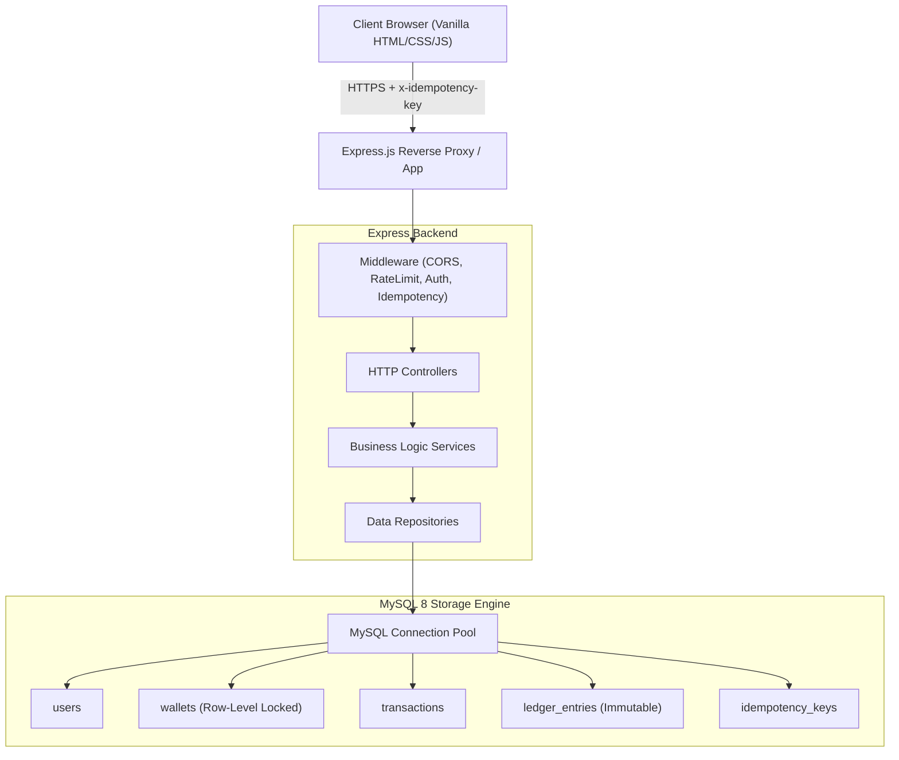

# PayBuddy Architecture & Technical Design Document

## 1. System Overview
PayBuddy is a production-inspired digital wallet and UPI payment platform engineered from the ground up to solve the core challenges of distributed financial software:
- **Zero Financial Drift:** Achieved via integer minor-unit math and immutable double-entry bookkeeping.
- **Deadlock-Free Concurrent Transfers:** Guaranteed via deterministic row-locking orders (`min(id)` then `max(id)`).
- **Network Fault Resilience:** Database-backed idempotency preventing double debits during network retries.

---

## 2. Component Architecture



---

## 3. Concurrency & Deadlock Prevention Strategy

### The Problem: Reciprocal Transfer Deadlock
When User A sends funds to User B at the exact millisecond User B sends funds to User A:
- **Thread 1 ($A \to B$):** Locks Wallet A, waits for lock on Wallet B.
- **Thread 2 ($B \to A$):** Locks Wallet B, waits for lock on Wallet A.
This forms a circular wait in InnoDB's lock graph, triggering `MySQL Error 1213: ER_LOCK_DEADLOCK`.

### The Solution: Deterministic Lock Acquisition Ordering
Before executing `SELECT ... FOR UPDATE`, PayBuddy deterministically sorts the wallet IDs:
```javascript
const [firstId, secondId] = [walletIdA, walletIdB].sort();
// Thread 1 and Thread 2 are guaranteed to lock the exact same resource first!
```
Because both threads request locks in identical global order, circular wait is mathematically impossible.

---

## 4. Double-Entry Bookkeeping Verification Formula

The authoritative balance of any wallet is governed by the invariant:

$$\text{Balance}_{\text{Authoritative}} = \sum \text{Credits} - \sum \text{Debits}$$

Every transfer creates exactly two entries in the `ledger_entries` table:
1. `DEBIT` on sender wallet
2. `CREDIT` on receiver wallet

$$\sum \text{Debits}_{\text{Tx}} = \sum \text{Credits}_{\text{Tx}}$$
