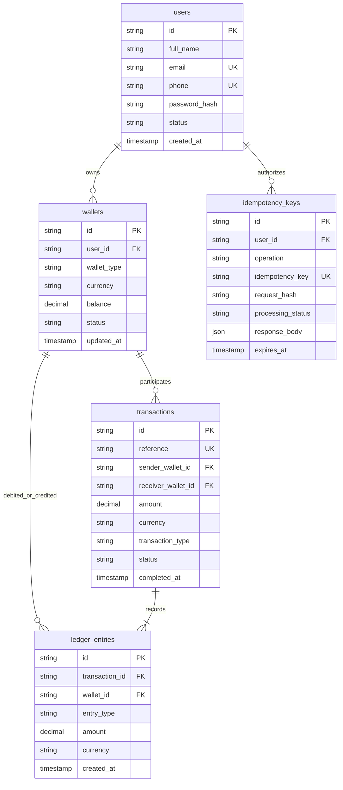

# PayBuddy Database Schema & Data Dictionary

## 1. Entity-Relationship Diagram

## 2. Integrity Invariants
1. `chk_wallet_balance_non_negative`: Enforces `balance >= 0.0000` at the database engine level.
2. `uq_user_wallet_type`: Restricts each user to at most one `MAIN` wallet per currency.
3. `fk_wallets_user` with `ON DELETE RESTRICT`: Prevents cascading deletions of accounts with historical financial records.
